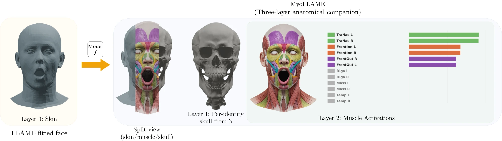
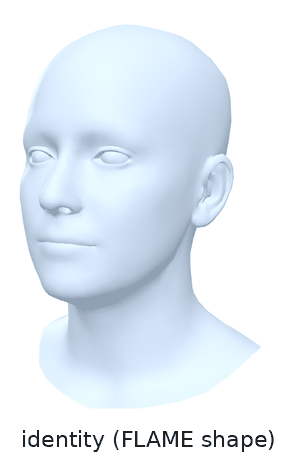

# MyoFLAME: Inverse-Physics Muscle Activation for Statistical 3D Face Models

This is the official PyTorch release of MyoFLAME (SIGGRAPH Asia 2026).

[Yixuan Shen](https://orcid.org/0009-0002-7653-0158), Yuyang Ji, Ren Wang, Kaidi Xu, Feng Liu

[Project page](https://vilab-group.com/project/myoflame/) | [BibTeX](#citation)

<p align="center"></p>

MyoFLAME is a muscle-driven companion to [FLAME](https://flame.is.tue.mpg.de). It takes the
same parameters as FLAME and tells you which facial muscles produce the expression: 50 named
muscle columns (zygomaticus major, frontalis, orbicularis oris, digastric, ...) with an
activation in [0, 1] each, and the skin those muscles produce, in FLAME topology. The
identity, head, neck, eye and jaw joints stay FLAME's own; only the expression blendshapes are
replaced by the muscle response. The jaw muscles drive FLAME's jaw joint: the digastric opens
the mouth, the masseter and temporalis close it.

<p align="center"></p>

Because the topology, the vertex order and the inputs are FLAME's, MyoFLAME drops into code
that already uses FLAME: FLAME 2020 fits from DECA, EMOCA or your own fitting give muscle
activations directly, and FLAME landmark embeddings, masks, UV maps and renderers work on
MyoFLAME meshes unchanged.

## Installation

The code was tested with Python 3.12 and PyTorch 2.6 on Linux; a CPU build of PyTorch is enough.

```
git clone https://github.com/VILab-Drexel/MyoFLAME.git
cd MyoFLAME
python3 -m venv .venv
source .venv/bin/activate
pip install -e .
```

The MyoFLAME model files (muscle response basis, activation surrogate, jaw calibration) are
part of the repository in `myoflame/data/` (61 MB) and need no separate download.

## Download FLAME

MyoFLAME runs on top of FLAME 2020, which cannot be redistributed. You need to sign up and
agree to the [FLAME model license](https://flame.is.tue.mpg.de/modellicense.html) at
https://flame.is.tue.mpg.de, download FLAME 2020 and copy `generic_model.pkl` into
`model/FLAME2020/`. MyoFLAME reads the file without chumpy. Other FLAME versions (for example
FLAME 2023, whose expression basis differs) are refused.

## Usage

```python
import torch
from myoflame import MyoFLAME

model = MyoFLAME("model/FLAME2020/generic_model.pkl")    # .to("cuda") for the GPU

# the arguments of smplx.FLAME; all optional, (B, n) each, truncated shape/expression are fine
out = model(betas=shape, expression=expression, jaw_pose=jaw_pose, global_orient=head_pose)

out.vertices        # (B, 5023, 3) muscle-driven skin, FLAME topology
out.activations     # (B, 50) muscle activations in [0, 1], names in model.muscle_names
out.jaw_open        # (B,) jaw opening in radians (0 to 20 degrees)
out.jaw_in_domain   # (B,) False where the jaw pose lies outside the calibrated range
```

Other FLAME conventions have adapters, so you do not need to reorder pose vectors:

```python
out = model.from_flame_pytorch(shape_params, expression_params, pose_params)   # FLAME_PyTorch: pose = [global, jaw]
out = model.from_deca(codedict)                                                  # DECA / EMOCA code dictionaries
```

Drive the face with muscles directly, or go back to FLAME parameters:

```python
a = torch.zeros(1, 50)
a[0, model.muscle_names.index("Zygomaticus_Major_L")] = 0.6
a[0, model.muscle_names.index("Digastric_L")] = a[0, model.muscle_names.index("Digastric_R")] = 0.5
out = model.from_activations(a)        # smile on the left side, jaw opened 10 degrees by the digastric
flame = model.to_flame(out)            # FLAME expression and jaw pose closest to that skin
```

Everything runs in batches on CPU or GPU (about 3 ms per sample on CPU and 0.3 ms per sample
on a GPU in batches of a few hundred) and is differentiable with respect to `betas`,
`expression`, the head, neck and eye poses and the activations. Gradients with respect to
`jaw_pose` flow through FLAME's jaw joint but not through the mapping to physical jaw
coordinates, so they do not reach the activations. `activation_mode="exact"` replaces the learned surrogate by
the exact inverse-physics solve (CPU, one bounded least-squares problem per sample, not
differentiable); use it for expressions far from the FACS-coded expressions the surrogate
was trained on.

## Demos

```
python demos/demo_forward.py --out output/forward
```

runs FACS-coded expressions of the D3DFACS dataset (shipped as FLAME 2020 parameters) through
MyoFLAME and writes, for each, the MyoFLAME mesh, the FLAME mesh and the strongest muscles.

```
python demos/demo_muscles.py --out output/muscles
```

drives the face one muscle (or muscle pair) at a time from rest to full contraction and
writes OBJ sequences, including the digastric opening the jaw and the masseter closing it.

## Model

The muscle columns, the jaw muscle law, the jaw calibration and the file formats are described
in [docs/MODEL.md](docs/MODEL.md). In short: 36 line-muscle columns pull skin towards their
bone origin, 8 ring columns (orbicularis oris in four quadrants, orbicularis oculi in its
orbital and palpebral parts on each side) contract rings of skin, and 6 jaw-muscle columns open
and close the jaw through

```
q_open = 20 deg * clip(mean(digastric) - 5.23 mean(masseter) - 2.10 mean(temporalis), 0, 1)
```

where 5.23 and 2.10 are the closers' torque capacities relative to the jaw-depressor group.
The activations are estimates of how much each muscle contributes to the observed FLAME
deformation, not measurements of muscle effort.

## Tests

```
python -m unittest discover -s tests -v
```

Tests that need FLAME skip until `model/FLAME2020/generic_model.pkl` is present.

## Citation

If you use MyoFLAME, please cite

```bibtex
@inproceedings{shen2026myoflame,
  title = {MyoFLAME: Inverse-Physics Muscle Activation for Statistical 3D Face Models},
  author = {Shen, Yixuan and Ji, Yuyang and Wang, Ren and Xu, Kaidi and Liu, Feng},
  booktitle = {ACM SIGGRAPH Asia Conference on Computer Graphics and Interactive Techniques (SIGGRAPH Asia)},
  year = {2026},
  doi = {10.1145/3829340.3842189},
}
```
